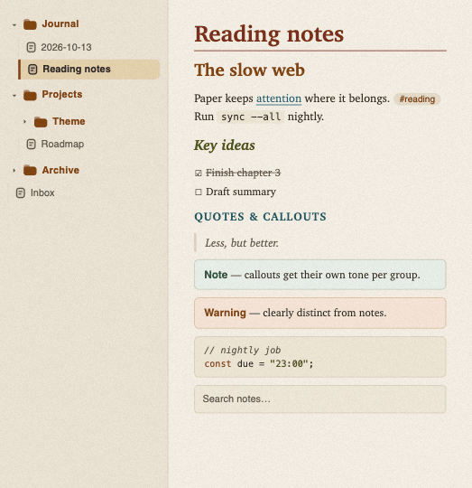
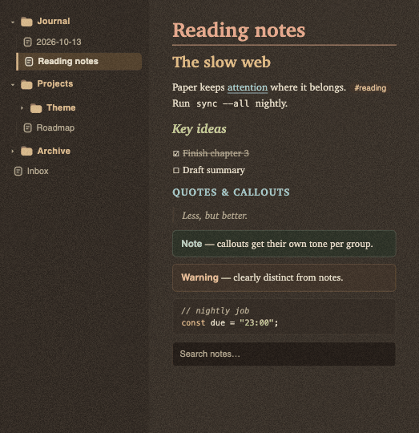
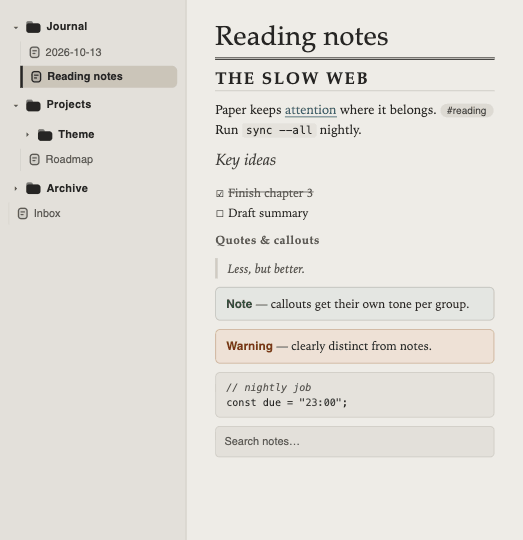
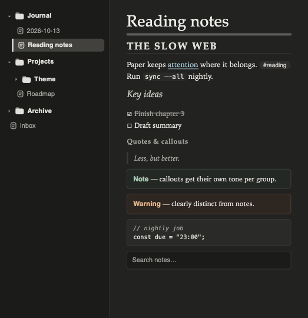
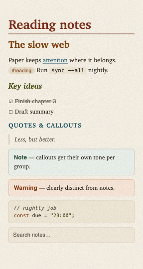
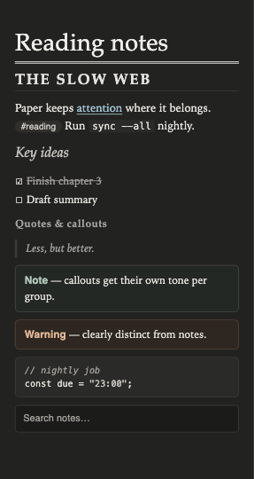

# Paper feel

A calm, paper-like app theme for [Obsidian](https://obsidian.md), in light and dark, for desktop and mobile. Easy on the eyes, with an unmistakable difference between heading levels, between folders and notes, and between callout types.

Two papers:

- **Cream Ledger** (default): warm cream paper with a subtle grain. Every heading level has its own ink.
- **Recycled Stock**: neutral grey paper, near-monochrome. Heading levels are told apart by typography: rules, capitals and italics.

Light and dark follow Obsidian's own setting (Settings → Appearance → Base color scheme).

| Cream Ledger, light | Cream Ledger, dark |
|---|---|
|  |  |

| Recycled Stock, light | Recycled Stock, dark |
|---|---|
|  |  |

Phone:  

> These images are design mockups (the paper grain is approximated). They'll be replaced with captures from Obsidian.

## Features

- Every text color meets WCAG AA (4.5:1) on the surface it sits on, in both papers and both modes, including code syntax and callout titles.
- Callouts in four groups with their own tint: info (note, abstract, info, todo, example, quote), warning (warning, question), danger (failure, danger, bug) and success (tip, important, success).
- File explorer: bold folders with a folder icon, muted notes with a note icon, the open note marked with a bar.
- Your accent color (Settings → Appearance → Accent color) still drives buttons, toggles and selection; headings, links and folders keep the paper's own inks.
- No remote resources, no embedded fonts, no JavaScript.

## Fonts

The theme names its fonts but doesn't embed them. Each one is used when it's installed on your system; otherwise the next one in the list applies.

- Cream Ledger: Charter for body and headings.
- Recycled Stock: Iowan Old Style for body, Palatino for headings.
- Interface: Helvetica Neue. Code: Menlo.

Change body, interface and code fonts in Settings → Appearance → Font.

## Settings

With the [Style Settings](https://github.com/mgmeyers/obsidian-style-settings) plugin you can choose:

- **Paper**: Cream Ledger (default) or Recycled Stock.
- **Paper texture**: On (default) or Off. Cream Ledger only.
- **Heading font**, one field per paper.

Without the plugin the theme uses Cream Ledger with the texture on.

## Installation

In Obsidian, open Settings → Appearance → Themes → Manage, search for **Paper feel**, then Install and use.

Manually: create the folder `.obsidian/themes/Paper feel/` in your vault, copy `theme.css` and `manifest.json` from the latest release into it, and select the theme under Settings → Appearance → Themes.

## Development

`theme.css` is generated. Edit `src/theme.css` (and `icons/`), then:

```sh
npm install      # once: stylelint and the official Obsidian config
npm run build    # src/theme.css + icons/ -> theme.css
npm run check    # contrast check (4.5:1, all palettes) + store lint (0 warnings)
```

The build needs Python 3 (standard library only). `docs/obsidian-theme-rules.md` lists the store and design rules the theme follows.

## License

[MIT](LICENSE)
